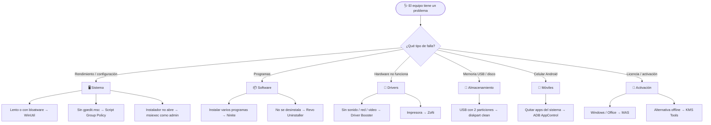

<a id="inicio"></a>

<div align="center">

# 🧰 Catálogo de Herramientas de Soporte Técnico

### Centro de Recursos Tecnológicos

*Kit del técnico para diagnosticar, reparar, optimizar y preparar equipos informáticos*

<br>


<br>

**[🔎 ¿Qué problema tienes?](#buscador)** &nbsp;•&nbsp;
**[🗺️ Diagnóstico](#diagnostico)** &nbsp;•&nbsp;
**[🚀 Flujo de formateo](#flujo)** &nbsp;•&nbsp;
**[📊 Comparativa](#comparativa)** &nbsp;•&nbsp;
**[📝 Observaciones](#observaciones)**

</div>

---

## 🧭 Menú de categorías

<div align="center">

| | Categoría | Herramientas | Ir |
|:-:|---|---|:-:|
| 🖥️ | **Sistema y configuración de Windows** | WinUtil · gpedit.msc · msiexec con privilegios | [](#cat-sistema) |
| 📦 | **Instalación y desinstalación de software** | Ninite · Revo Uninstaller | [](#cat-software) |
| 🔧 | **Drivers y controladores** | Driver Booster · Zofti (impresoras) | [](#cat-drivers) |
| 💾 | **Almacenamiento** | diskpart (USB doble partición) | [](#cat-almacenamiento) |
| 📱 | **Dispositivos móviles** | ADB AppControl | [](#cat-moviles) |
| 🔑 | **Activación y licenciamiento** | MAS · KMS Tools / KMS Lite | [](#cat-activacion) |
| 🗄️ | **Bases de datos y virtualización** | SQL Server antiguos · VMware Workstation | [](#cat-virtualizacion) |

</div>

> [!TIP]
> Cada herramienta es una **tarjeta desplegable**. Haz clic en su título (▶) para ver el contexto, para qué sirve y los pasos de uso.

### 🏷️ Leyenda de etiquetas

| Etiqueta | Significado |
|---|---|
|  | Uso seguro, cambios reversibles o sin impacto en el sistema |
|  | Modifica el sistema: conviene crear un punto de restauración |
|  | Puede borrar datos, ser detectado como malware o tener implicaciones legales |
|  | Necesita ejecutarse como Administrador |

---

<a id="buscador"></a>

## 🔎 ¿Qué problema tienes?

> Busca el síntoma del equipo y salta directamente a la herramienta indicada.

| 🩺 Síntoma / necesidad | 🛠️ Herramienta recomendada | ⏱️ Tiempo |
|---|---|:-:|
| Windows lento, lleno de bloatware o telemetría | [WinUtil (Chris Titus)](#winutil) | 10–20 min |
| Un programa no se deja desinstalar o deja restos | [Revo Uninstaller](#revo) | 5 min |
| Un instalador `.msi` / `.exe` no abre o falla por permisos | [msiexec con privilegios](#msiexec) | 2 min |
| Equipo recién formateado sin programas básicos | [Ninite](#ninite) · [WinUtil](#winutil) | 5–10 min |
| Falta sonido, Wi-Fi, video o hay dispositivos desconocidos | [Driver Booster](#driverbooster) | 10–15 min |
| La impresora no imprime o no se reconoce | [Drivers Zofti](#zofti) | 5–10 min |
| No existe `gpedit.msc` (Windows Home) | [Habilitar gpedit](#gpedit) | 5 min |
| Memoria USB muestra menos capacidad o tiene 2 particiones | [diskpart](#diskpart) | 3 min |
| Celular Android con apps basura que no se pueden quitar | [ADB AppControl](#adb) | 10 min |
| Windows / Office muestra “Activar” o marca de agua | [MAS](#mas) · [KMS Tools](#kms) | 5 min |
| Un software antiguo exige SQL Server 2005/2008/2012 | [SQL Server antiguos](#sql) | 30+ min |
| Probar un sistema o programa sin arriesgar el equipo | [VMware Workstation](#vmware) | 20+ min |

---

<a id="diagnostico"></a>

## 🗺️ Árbol de diagnóstico rápido



---

<a id="cat-sistema"></a>

## 🖥️ 1. Sistema y configuración de Windows


> **Contexto:** herramientas para dejar Windows rápido, limpio y totalmente configurable. Son lo primero que se aplica cuando un equipo “va lento” o cuando se necesita acceso a opciones avanzadas que Windows oculta.

<a id="winutil"></a>

<details>
<summary><b>🧙 Chris Titus Tech – Windows Utility (WinUtil)</b> &nbsp;   </summary>

<br>

| Ficha | |
|---|---|
| **Tipo** | Script PowerShell de código abierto (navaja suiza para Windows) |
| **Licencia** | Gratuita · MIT |
| **Requiere** | Windows 10/11, PowerShell como Administrador, Internet |
| **En el repo** | [README](Herramientas/Sistemas/ChrisTitus-Tech-Utility/README.md) · [INSTALADOR DE APP.txt](PC/INSTALADOR%20DE%20APP.txt) |

#### 📖 Contexto
Creada por el youtuber y administrador de sistemas *Chris Titus*, reúne en una sola ventana tareas que normalmente requieren decenas de clics, ediciones de registro y comandos.

#### 🎯 ¿Para qué sirve?
- **Install:** instalar/actualizar muchos programas a la vez usando `winget` o `chocolatey`.
- **Tweaks:** eliminar bloatware, desactivar telemetría, servicios innecesarios, Copilot, etc.
- **Config:** activar características de Windows (.NET, Hyper-V, WSL) y paneles clásicos.
- **Updates:** controlar Windows Update (solo seguridad, pausar, predeterminado).
- **MicroWin:** crear una ISO de Windows reducida.

#### 🛠️ Aplicación de uso
1. Clic derecho en Inicio → **Terminal (Administrador)** / **Windows PowerShell (Administrador)**.
2. Pegar el comando:
   ```powershell
   irm https://christitus.com/win | iex
   ```
   *(El repositorio usa la variante equivalente `iwr -useb https://christitus.com/win | iex`.)*
3. En la pestaña **Tweaks** elegir el perfil *Standard* → **Run Tweaks**.
4. En **Install** marcar los programas deseados → **Install/Upgrade Selected**.

> [!WARNING]
> Crea un **punto de restauración** antes de aplicar *Tweaks* (la propia herramienta tiene la opción). Evita los ajustes marcados como *Advanced* si no sabes qué hacen.

</details>

<a id="gpedit"></a>

<details>
<summary><b>📜 Habilitar el Editor de Directivas de Grupo Local (gpedit.msc)</b> &nbsp;   </summary>

<br>

| Ficha | |
|---|---|
| **Tipo** | Script por lotes (`Group_Policy.bat`) |
| **Requiere** | Windows 10/11 **Home**, Administrador |
| **En el repo** | [Guía](Guia/Sistema/Habilitar-GPEDIT-Local/README.md) · [Script](Scripts/Windows/Group-Policy-Editor/README.md) · [Original](PC/Habilitar%20el%20Editor%20de%20Directivas%20de%20Grupo%20Local) |

#### 📖 Contexto
Las ediciones **Home** de Windows no incluyen `gpedit.msc`, aunque los paquetes necesarios sí vienen dentro del sistema. El script los registra con DISM.

#### 🎯 ¿Para qué sirve?
Acceder a directivas avanzadas sin editar el registro a mano: bloquear actualizaciones automáticas, desactivar Cortana/OneDrive, restringir USB, políticas de contraseñas, scripts de inicio, etc.

#### 🛠️ Aplicación de uso
1. Descargar el script: [Group_Policy.bat (MediaFire)](https://www.mediafire.com/file/wvq07imzsmfli6e/Group_Policy.bat/file).
2. Clic derecho → **Ejecutar como administrador** y esperar a que termine.
3. Comprobar: <kbd>Win</kbd> + <kbd>R</kbd> → escribir `gpedit.msc` → <kbd>Enter</kbd>.

<details>
<summary>💡 <i>Alternativa sin descargar nada (CMD como administrador)</i></summary>

<br>

```bat
FOR %F IN ("%SystemRoot%\servicing\Packages\Microsoft-Windows-GroupPolicy-ClientTools-Package~*.mum") DO (DISM /Online /NoRestart /Add-Package:"%F")
FOR %F IN ("%SystemRoot%\servicing\Packages\Microsoft-Windows-GroupPolicy-ClientExtensions-Package~*.mum") DO (DISM /Online /NoRestart /Add-Package:"%F")
```

> Dentro de un archivo `.bat` se escribe `%%F` en lugar de `%F`.

</details>

</details>

<a id="msiexec"></a>

<details>
<summary><b>⚙️ “No ejecuta App” – Lanzar msiexec con privilegios de administrador</b> &nbsp;   </summary>

<br>

| Ficha | |
|---|---|
| **Tipo** | Procedimiento nativo de Windows (sin instalar nada) |
| **Requiere** | Cuenta con permisos de administrador |
| **En el repo** | [Instruccion.JPG](PC/No%20ejecuta%20App.exe/Instruccion.JPG) |

#### 📖 Contexto
A veces un instalador no hace nada al darle doble clic, falla con errores de permisos (por ejemplo *2502 / 2503*) o el servicio **Windows Installer** queda bloqueado. Lanzarlo desde el Administrador de tareas con privilegios elevados suele resolverlo.

#### 🎯 ¿Para qué sirve?
Ejecutar `msiexec.exe` (motor de instalación de Windows) o cualquier instalador con permisos de administrador cuando el método normal no funciona.

#### 🛠️ Aplicación de uso
1. Abrir el Administrador de tareas: <kbd>Ctrl</kbd> + <kbd>Shift</kbd> + <kbd>Esc</kbd>.
2. **Archivo → Ejecutar nueva tarea**.
3. Escribir `msiexec.exe` (o la ruta completa del instalador).
4. ✅ Marcar **“Crear esta tarea con privilegios administrativos”** → **Aceptar**.

Para instalar un `.msi` concreto:
```bat
msiexec /i "C:\Ruta\al\instalador.msi"
```

<details>
<summary>🖼️ <i>Ver captura de referencia</i></summary>

<br>


</details>

</details>

<div align="right"><a href="#inicio">⬆️ Volver arriba</a></div>

---

<a id="cat-software"></a>

## 📦 2. Instalación y desinstalación de software


> **Contexto:** ahorrar tiempo al preparar un equipo (instalar todo de una vez) y limpiar a fondo cuando un programa está dañado, no se deja quitar o deja basura en el registro.

<a id="ninite"></a>

<details>
<summary><b>⚡ Ninite</b> &nbsp;  </summary>

<br>

| Ficha | |
|---|---|
| **Tipo** | Servicio web que genera un instalador personalizado |
| **Licencia** | Gratuito para uso personal |
| **Requiere** | Navegador e Internet |
| **En el repo** | [README](Herramientas/Sistemas/Ninite/README.md) · [INSTALAR APP PRACTICO.txt](PC/INSTALAR%20APP%20PRACTICO.txt) |

#### 📖 Contexto
Instalar programas uno por uno implica descargar, pulsar “Siguiente” muchas veces y esquivar barras de herramientas. Ninite lo automatiza todo.

#### 🎯 ¿Para qué sirve?
- Instalar en **un solo paso** navegadores, compresores, reproductores, runtimes, etc.
- Instalación **silenciosa** y **sin publicidad** ni software adicional.
- Volver a ejecutar el mismo instalador **actualiza** los programas.

#### 🛠️ Aplicación de uso
1. Entrar a [ninite.com](https://ninite.com/).
2. Marcar las aplicaciones (ej.: Chrome, 7-Zip, VLC, Zoom, .NET, Java).
3. Clic en **Get Your Ninite** y ejecutar el `.exe` descargado.
4. Esperar a que termine — no hay que pulsar nada más.

> [!TIP]
> Guarda tu `Ninite.exe` personalizado en una memoria USB para reutilizarlo en cada equipo que atiendas.

</details>

<a id="revo"></a>

<details>
<summary><b>🗑️ Revo Uninstaller Pro</b> &nbsp;   </summary>

<br>

| Ficha | |
|---|---|
| **Tipo** | Desinstalador avanzado |
| **Licencia** | Pro: de pago (prueba 30 días) · existe versión Free |
| **Requiere** | Windows |
| **En el repo** | [README](Herramientas/Desinstalacion/Revo-Uninstaller/README.md) · [RevoUninProSetup.exe](PC/RevoUninProSetup.exe) · [Forzar eliminación de Apps](PC/Forzar%20eliminacion%20de%20Apps) |

#### 📖 Contexto
El desinstalador de Windows suele dejar carpetas, archivos y claves de registro huérfanas. Si la desinstalación se corrompe, el programa ya no se puede quitar **ni reinstalar**.

#### 🎯 ¿Para qué sirve?
- **Desinstalación completa:** ejecuta el desinstalador y luego escanea restos.
- **Desinstalación forzada:** elimina programas rotos o que no aparecen en la lista.
- **Modo cazador:** desinstalar arrastrando el ícono de una ventana o acceso directo.
- Limpieza de rastros de navegadores y archivos basura.

#### 🛠️ Aplicación de uso
1. Instalar con [RevoUninProSetup.exe](PC/RevoUninProSetup.exe) o desde el [sitio oficial](https://www.revouninstaller.com/es/products/revo-uninstaller-pro/).
2. Seleccionar el programa → **Desinstalar**.
3. Tras el desinstalador original, elegir modo de escaneo **Avanzado**.
4. Marcar las entradas de registro y archivos sobrantes (en **negrita**) → **Eliminar**.
5. Si el programa no aparece: **Desinstalación forzada** → indicar el nombre o la ruta del `.exe`.

> [!WARNING]
> Revisa lo que marcas en el registro: borra solo lo que está en **negrita** (lo que Revo identifica como del programa).

</details>

<div align="right"><a href="#inicio">⬆️ Volver arriba</a></div>

---

<a id="cat-drivers"></a>

## 🔧 3. Drivers y controladores


> **Contexto:** sin el controlador correcto, el hardware no funciona o funciona mal (sin audio, sin Wi-Fi, pantalla en baja resolución, impresora no detectada). Son críticos después de formatear.

<a id="driverbooster"></a>

<details>
<summary><b>🚀 IObit Driver Booster – “La app que repara todo”</b> &nbsp;   </summary>

<br>

| Ficha | |
|---|---|
| **Tipo** | Actualizador automático de controladores |
| **Licencia** | Free / Pro (de pago) |
| **Requiere** | Windows, Internet |
| **En el repo** | [README](Herramientas/Sistemas/Driver-Booster/README.md) · [APP Repara - Driver Booster.exe](PC/APP%20Repara%20-%20Driver%20Booster.exe) · [APP QUE REPARA TODO.txt](PC/APP%20QUE%20REPARA%20TODO.txt) |

#### 📖 Contexto
Buscar drivers manualmente para cada componente (chipset, audio, red, video) es lento. Driver Booster detecta el hardware y descarga los drivers desde su base de datos.

#### 🎯 ¿Para qué sirve?
- Detectar **drivers faltantes, obsoletos o dañados**.
- Instalar componentes de juegos (DirectX, Visual C++, .NET).
- Herramientas extra: **reparar sin sonido, sin red, resolución incorrecta**.
- Respaldo y restauración de drivers.

#### 🛠️ Aplicación de uso
1. Instalar con [APP Repara - Driver Booster.exe](PC/APP%20Repara%20-%20Driver%20Booster.exe) (o desde [iobit.com](https://www.iobit.com/es/driver-booster.php)).
2. **Desmarcar** los programas adicionales que ofrece el instalador.
3. Pulsar **Escanear** → **Actualizar ahora**.
4. Reiniciar el equipo al terminar.

> [!IMPORTANT]
> Activa la opción de **crear punto de restauración** antes de actualizar. Para portátiles de marca, prioriza los drivers del fabricante (HP, Lenovo, Dell, Asus) si algo falla.

</details>

<a id="zofti"></a>

<details>
<summary><b>🖨️ Drivers de todas las impresoras (Zofti)</b> &nbsp;  </summary>

<br>

| Ficha | |
|---|---|
| **Tipo** | Sitio web de descargas de drivers |
| **Requiere** | Navegador, modelo exacto de la impresora |
| **En el repo** | [README](Herramientas/Impresoras/Drivers-Impresoras-Zofti/README.md) · [Enlace](Recursos/Drivers/DRIVERS-DE-TODAS-LAS-IMPRESORAS.txt) |

#### 📖 Contexto
Las impresoras son de los periféricos que más soporte demandan. Zofti centraliza drivers de Epson, HP, Canon, Brother, Ricoh y otras marcas, incluidos modelos antiguos.

#### 🎯 ¿Para qué sirve?
Encontrar rápidamente el controlador correcto cuando la impresora no se detecta, imprime caracteres extraños o se reinstaló Windows.

#### 🛠️ Aplicación de uso
1. Identificar el **modelo exacto** (etiqueta trasera o inferior de la impresora).
2. Entrar a [zofti.com](https://zofti.com/) y buscar el modelo.
3. Descargar el driver para la versión de Windows (32/64 bits).
4. Instalar con la impresora **desconectada** y conectarla cuando el asistente lo pida.

</details>

<div align="right"><a href="#inicio">⬆️ Volver arriba</a></div>

---

<a id="cat-almacenamiento"></a>

## 💾 4. Almacenamiento


> **Contexto:** memorias USB que fueron booteables (instaladores de Windows/Linux) suelen quedar con particiones raras y mostrar menos capacidad. Windows no siempre permite repararlas desde el Explorador.

<a id="diskpart"></a>

<details>
<summary><b>🧹 USB doble partición – Limpieza con diskpart</b> &nbsp;   </summary>

<br>

| Ficha | |
|---|---|
| **Tipo** | Utilidad de línea de comandos incluida en Windows |
| **Requiere** | CMD como Administrador |
| **En el repo** | [Guía](Guia/Almacenamiento/USB-Doble-Partition/README.md) · [Original](PC/UBS%20DOBLE%20PARTICION.txt) |

#### 📖 Contexto
`diskpart` gestiona discos y particiones a bajo nivel. El comando `clean` borra la tabla de particiones completa, dejando la USB como nueva.

#### 🎯 ¿Para qué sirve?
- Recuperar la **capacidad total** de una USB con dos particiones.
- Reparar memorias que Windows “no puede formatear”.
- Preparar una unidad antes de hacerla booteable.

#### 🛠️ Aplicación de uso
> Reemplaza `X` por el número de la USB (identifícala por su tamaño en `list disk`).

```bat
diskpart
list disk
select disk X
detail disk
clean
create partition primary
format fs=ntfs quick
assign
exit
```
**Opción del repositorio:** tras `clean`, abrir **Administración de equipos → Administración de discos**, clic derecho sobre el espacio *No asignado* → **Nuevo volumen simple**.

> [!CAUTION]
> `clean` **borra todo el disco seleccionado sin confirmación**. Si eliges el disco equivocado perderás los datos del disco duro. Verifica siempre con `detail disk`.

</details>

<div align="right"><a href="#inicio">⬆️ Volver arriba</a></div>

---

<a id="cat-moviles"></a>

## 📱 5. Dispositivos móviles


> **Contexto:** muchos celulares Android traen aplicaciones del fabricante u operador (bloatware) que consumen batería, datos y almacenamiento y que no se pueden desinstalar normalmente.

<a id="adb"></a>

<details>
<summary><b>🤖 ADB AppControl</b> &nbsp;  </summary>

<br>

| Ficha | |
|---|---|
| **Tipo** | Interfaz gráfica para ADB (Android Debug Bridge) |
| **Licencia** | Gratuita (funciones extra de pago) |
| **Requiere** | PC Windows, cable USB, **Depuración USB** activada |
| **En el repo** | [README](Herramientas/Celulares/ADB-AppControl/README.md) · [Original](CELULARES/DESISTALAR%20APP%20ANDROID.txt) |

#### 📖 Contexto
ADB es la herramienta oficial de Google para comunicarse con Android desde la PC, pero se usa por comandos. ADB AppControl la convierte en una ventana con listas y casillas.

#### 🎯 ¿Para qué sirve?
- **Desinstalar o desactivar apps del sistema sin root**.
- Instalar APKs en lote y respaldar APKs instaladas.
- Gestionar permisos, ver información del dispositivo y limpiar caché.

#### 🛠️ Aplicación de uso
1. En el celular: **Ajustes → Acerca del teléfono** → tocar 7 veces **Número de compilación**.
2. **Opciones de desarrollador → Depuración USB** = activada.
3. Descargar e instalar desde [adbappcontrol.com](https://adbappcontrol.com/en/).
4. Conectar el cable y **aceptar la huella RSA** en la pantalla del celular.
5. Marcar las apps no deseadas → preferir **Desactivar** antes que **Desinstalar**.

> [!WARNING]
> Quitar apps esenciales del sistema (launcher, servicios de Google, teléfono) puede provocar bucles de reinicio. Desactiva primero, prueba y luego elimina.

</details>

<div align="right"><a href="#inicio">⬆️ Volver arriba</a></div>

---

<a id="cat-activacion"></a>

## 🔑 6. Activación y licenciamiento


> **Contexto:** herramientas para activar Windows y Office. Se usan cuando el sistema muestra la marca de agua *“Activar Windows”* o Office entra en modo de funcionalidad reducida.

> [!CAUTION]
> Estas herramientas **no son oficiales de Microsoft**. Activar sin una licencia válida puede infringir los términos de uso. Además, los antivirus suelen detectarlas como *HackTool*, y los paquetes obtenidos de sitios de cracks pueden contener malware. Úsalas solo en equipos donde exista licenciamiento aplicable y, de preferencia, pruébalas primero en una [máquina virtual](#vmware).

<a id="mas"></a>

<details>
<summary><b>🪄 Microsoft Activation Script (MAS)</b> &nbsp;   </summary>

<br>

| Ficha | |
|---|---|
| **Tipo** | Script de código abierto |
| **Requiere** | PowerShell como Administrador, Internet |
| **En el repo** | [README](Herramientas/Activacion/Microsoft-Activation-Script-MAS/README.md) · [Original](PC/MICROSOFT%20ACTIVATION%20SCRIPT%20(MAS).txt) |

#### 📖 Contexto
Proyecto de código abierto documentado en [massgrave.dev](https://massgrave.dev/). No requiere descargar ejecutables: se lanza con un comando de PowerShell.

#### 🎯 ¿Para qué sirve?
Ofrece varios métodos según el producto: **HWID** (Windows 10/11), **Ohook** (Office), **TSforge** y **Online KMS** (Windows/Office por 180 días renovables). También permite revisar el estado de activación.

#### 🛠️ Aplicación de uso
1. Abrir **PowerShell (Administrador)**.
2. Ejecutar:
   ```powershell
   irm https://get.activated.win | iex
   ```
3. En el menú, elegir el número del método correspondiente al producto.
4. Verificar en **Configuración → Sistema → Activación**.

</details>

<a id="kms"></a>

<details>
<summary><b>🧩 Ratiborus KMS Tools Lite / KMS Lite (carpeta “Desbloquear”)</b> &nbsp;   </summary>

<br>

| Ficha | |
|---|---|
| **Tipo** | Colección de utilidades portables (versión 07.09.2024) |
| **Requiere** | Administrador; desactivar temporalmente el antivirus |
| **Contraseña** | `123` para *KMS Tools* (ver [archivo original](PC/Desbloquear/KMS%20Lite%20-%20Contrase%C3%B1a.txt)) |
| **En el repo** | [README KMS Tools](Scripts/Activacion/KMS-Tools/README.md) · [README KMS Lite](Herramientas/Desbloquear/KMS-Lite-Info/README.md) · [Carpeta PC/Desbloquear](PC/Desbloquear/) |

#### 📖 Contexto
Paquete muy difundido en soporte técnico que agrupa activadores y utilidades de mantenimiento de Office. A diferencia de MAS, funciona **sin conexión** (KMSoffline incluye una lista de servidores KMS en `KMSoffline.ini`).

#### 🎯 ¿Para qué sirve?

| Utilidad incluida | Función |
|---|---|
| **AAct Network v1.4.1** | Activación KMS de Windows/Office |
| **KMSoffline v2.4.3** | Activación contra servidores KMS configurables |
| **W10 Digital Activation v1.5.5.3** | Licencia digital para Windows 10/11 |
| **KMSCleaner v2.5.1** | Elimina restos de activadores KMS anteriores |
| **Office Installer v1.16** | Descarga e instala Office (selección de componentes) |
| **Office Uninstall v2.0.2** | Desinstala Office por completo cuando el desinstalador falla |
| **ClearTemp v1.6.0** | Limpieza de archivos temporales |

#### 🛠️ Aplicación de uso
1. Descomprimir `KMS Tools.zip` / `KMS.Tools.Lite.rar` (contraseña indicada arriba).
2. Ejecutar **KMS Tools Portable** como administrador.
3. Elegir la utilidad según la necesidad (ej.: *Office Uninstall* para limpiar un Office dañado antes de reinstalar).
4. Consultar la ayuda incluida: `KMS Tools Portable.chm`.

</details>

<div align="right"><a href="#inicio">⬆️ Volver arriba</a></div>

---

<a id="cat-virtualizacion"></a>

## 🗄️ 7. Bases de datos y virtualización


> **Contexto:** recursos para entornos especiales: software empresarial antiguo que depende de versiones concretas de SQL Server y laboratorios virtuales para pruebas seguras.

<a id="sql"></a>

<details>
<summary><b>🗃️ Versiones antiguas de SQL Server</b> &nbsp;  </summary>

<br>

| Ficha | |
|---|---|
| **Tipo** | Enlace a recopilación de instaladores |
| **Requiere** | Navegador; requisitos propios de cada versión (.NET Framework) |
| **En el repo** | [README](Recursos/SQL/Versiones-SQL-Server-Antiguas/README.md) · [Enlace](Recursos/SQL/Versiones_SQL_Server.enlace.txt) |

#### 📖 Contexto
Muchos sistemas contables, de facturación o de punto de venta solo funcionan con una versión específica de SQL Server (2005, 2008 R2, 2012…) que Microsoft ya no publica fácilmente.

#### 🎯 ¿Para qué sirve?
Descargar la versión exacta (Express o completa) que exige un software heredado al migrarlo a un equipo nuevo.

#### 🛠️ Aplicación de uso
1. Confirmar con el proveedor del software qué versión y edición necesita.
2. Entrar a [zonasql.com](https://zonasql.com/descargar-versiones-antiguas-de-sql-server) y descargar.
3. Activar **.NET Framework 3.5** si la versión lo requiere (*Características de Windows*).
4. Instalar con el modo de autenticación y la instancia que pida el software.

</details>

<a id="vmware"></a>

<details>
<summary><b>💻 VMware Workstation (26H1)</b> &nbsp;   </summary>

<br>

| Ficha | |
|---|---|
| **Tipo** | Hipervisor de escritorio (máquinas virtuales) |
| **Licencia** | Gratuito para uso personal y comercial |
| **Requiere** | CPU con virtualización (Intel VT-x / AMD-V) activada en BIOS, 8 GB+ de RAM recomendados |
| **En el repo** | [VMware-Workstation-Full-26H1-25388281.exe](Recursos/Virtualizacion/VMware-Workstation-Full-26H1-25388281.exe) *(~274 MB, Git LFS)* |

#### 📖 Contexto
Permite ejecutar otros sistemas operativos dentro de una ventana, aislados del equipo real. Es el “laboratorio” del técnico.

#### 🎯 ¿Para qué sirve?
- Probar herramientas dudosas (activadores, scripts) **sin riesgo** para el equipo principal.
- Ejecutar programas antiguos en Windows XP/7.
- Practicar formateos, particionado y configuración de redes.
- Usar **instantáneas (snapshots)** para volver atrás en segundos.

#### 🛠️ Aplicación de uso
1. Activar la virtualización en la BIOS/UEFI.
2. Instalar con el `.exe` del repositorio.
3. **Create a New Virtual Machine** → seleccionar la ISO del sistema.
4. Asignar RAM, CPU y disco → instalar el sistema invitado.
5. Instalar **VMware Tools** y tomar una instantánea limpia.

</details>

<div align="right"><a href="#inicio">⬆️ Volver arriba</a></div>

---

<a id="flujo"></a>

## 🚀 Flujo recomendado: preparar un equipo desde cero


<details>
<summary>📋 <b>Checklist imprimible</b> (clic para desplegar)</summary>

<br>

- [ ] Respaldar datos del cliente
- [ ] Limpiar y preparar USB booteable → [diskpart](#diskpart)
- [ ] Instalar Windows
- [ ] Instalar drivers → [Driver Booster](#driverbooster)
- [ ] Verificar activación → [MAS](#mas) / licencia del cliente
- [ ] Instalar programas básicos → [Ninite](#ninite) / [WinUtil](#winutil)
- [ ] Aplicar optimizaciones → [WinUtil Tweaks](#winutil)
- [ ] Configurar impresora → [Zofti](#zofti)
- [ ] Crear punto de restauración final

</details>

---

<a id="comparativa"></a>

## 📊 Comparativa general

| Herramienta | Categoría | Tipo | Gratis | Internet | Admin | Riesgo |
|---|---|---|:-:|:-:|:-:|:-:|
| [WinUtil](#winutil) | 🖥️ Sistema | Script PS | ✅ | ✅ | ✅ | 🟡 |
| [gpedit.msc](#gpedit) | 🖥️ Sistema | Script .bat | ✅ | ⬇️ | ✅ | 🟢 |
| [msiexec admin](#msiexec) | 🖥️ Sistema | Nativo | ✅ | ❌ | ✅ | 🟢 |
| [Ninite](#ninite) | 📦 Software | Web | ✅ | ✅ | ✅ | 🟢 |
| [Revo Uninstaller](#revo) | 📦 Software | App | 🔸 | ❌ | ✅ | 🟡 |
| [Driver Booster](#driverbooster) | 🔧 Drivers | App | 🔸 | ✅ | ✅ | 🟡 |
| [Zofti](#zofti) | 🔧 Drivers | Web | ✅ | ✅ | ✅ | 🟢 |
| [diskpart](#diskpart) | 💾 Almacenamiento | Nativo | ✅ | ❌ | ✅ | 🔴 |
| [ADB AppControl](#adb) | 📱 Móviles | App | 🔸 | ⬇️ | ❌ | 🟡 |
| [MAS](#mas) | 🔑 Activación | Script PS | ✅ | ✅ | ✅ | 🔴 |
| [KMS Tools](#kms) | 🔑 Activación | Portable | ✅ | ❌ | ✅ | 🔴 |
| [SQL Server antiguos](#sql) | 🗄️ BD | Web | ✅ | ✅ | ✅ | 🟢 |
| [VMware Workstation](#vmware) | 🗄️ Virtualización | App | ✅ | ❌ | ✅ | 🟢 |

<sub>✅ Sí · ❌ No · ⬇️ Solo para descargar · 🔸 Versión gratuita limitada / funciones de pago · 🟢 Bajo · 🟡 Medio · 🔴 Alto</sub>

---

<a id="observaciones"></a>

## 📝 Observaciones del repositorio

<details>
<summary>🔍 <b>Duplicados y sugerencias de orden</b> (clic para desplegar)</summary>

<br>

| Hallazgo | Ubicaciones | Sugerencia |
|---|---|---|
| Instalador de VMware duplicado (mismo archivo LFS, ~274 MB) | `OTROS/MAQUINAS VIRTUALES/` y `Recursos/Virtualizacion/` | Conservar solo `Recursos/Virtualizacion/` |
| Enlace de drivers de impresoras duplicado | `OTROS/` y `Recursos/Drivers/` | Conservar `Recursos/Drivers/` |
| Enlace de SQL Server duplicado | `OTROS/Versiones_SQL_Server` y `Recursos/SQL/` | Conservar `Recursos/SQL/` |
| Guía de gpedit en dos sitios | `Guia/Sistema/` y `Scripts/Windows/` | Unificar en una sola carpeta |
| Información de KMS dividida | `Herramientas/Desbloquear/` y `Scripts/Activacion/` | Unificar en `Herramientas/Activacion/` |
| Carpetas vacías | `Documentacion/Guias`, `Documentacion/Referencias` | Usarlas o eliminarlas |
| Acceso directo a sitio de cracks | `PC/Desbloquear/Descarga.xyz….url` | Considerar eliminarlo (riesgo de malware) |

</details>

---

<div align="center">

**🧰 Centro de Recursos Tecnológicos** · Catálogo de herramientas de soporte técnico

[⬆️ Volver al inicio](#inicio) · [📘 README principal](README.md)

</div>
